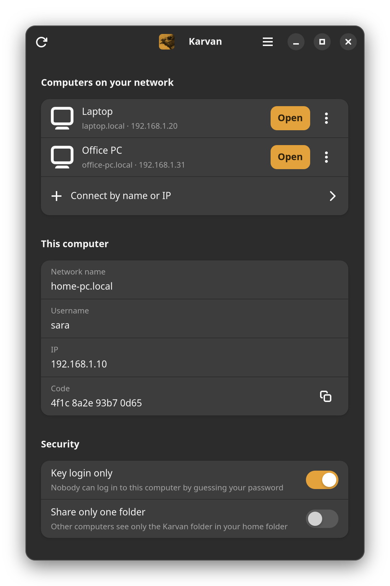

**English** | [فارسی](README.fa.md)

# Karvan

Browse the files of another Ubuntu computer on your home network from the
Files app. You can do it in both directions, with no terminal needed after
installation.

Karvan is a small GNOME app built on things Ubuntu already has: SSH/SFTP for
the connection, Avahi (mDNS) to find the other computers, Files (Nautilus) to
show their files, and GTK 4 with libadwaita for its window.



## Features

- **Set up this computer.** Installs and enables the SSH server, makes the
  computer discoverable on the local network, and opens the firewall for the
  local network only.
- **Open files on another computer.** Lists the Karvan computers it finds on
  your network and opens the one you pick in Files. It remembers your username
  on each computer and can add it to the Files sidebar.
- **Send to another computer.** Right-click files or folders in Files to send
  them to another computer's Downloads folder.
- **Passwordless login.** Creates an SSH key if needed and copies it to the
  other computer.
- **Key login only.** Turns off SSH password login on this computer.
- **Share only one folder.** Other computers see only the `Karvan` folder in
  your home folder instead of all your files.
- **Checks the other computer on first connection.** Both computers show the
  same short code, so you know you reached the right one.
- **English and Persian.** Karvan follows the system language, and the main
  menu (☰) switches it. In Persian the whole window is laid out right to left.
- **Follows your system style,** including light and dark mode.

## Requirements

- Ubuntu 24.04 or newer, desktop edition (GNOME with Files/Nautilus). Tested
  on 24.04 and 26.04; computers on different versions work together.
- GTK 4 and libadwaita 1.5 or newer for Python. Ubuntu Desktop usually has
  them; if Karvan says they're missing, run
  `sudo apt install python3-gi gir1.2-gtk-4.0 gir1.2-adw-1`
- An administrator account on each computer (needed once, for setup)
- All computers on the same local network

## Installation

Do these steps on **each** computer.

### 1. Install Karvan

**Easiest: the .deb package.** Download `karvan_<version>_all.deb` from the
[Releases page](https://github.com/moxart/karvan/releases), then double-click
it, or run:

```bash
sudo apt install ./karvan_*_all.deb
```

**Or from the source code**, without administrator rights:

```bash
git clone https://github.com/moxart/karvan.git
cd karvan
bash karvan.sh --install
```

This copies Karvan to `~/.local/bin/karvan` and `~/.local/share/karvan`,
installs its icon and adds **Karvan** to your applications menu. You can delete
the cloned folder afterwards. If `git` is not installed, install it with
`sudo apt install git`, or download the ZIP from GitHub
(**Code → Download ZIP**) and extract it.

To build the package yourself, run `bash packaging/build-deb.sh`; it's saved in
`dist/`.

### 2. Set up the computer

Open **Karvan** from the applications menu and click **Set up** under
**This computer**. Enter your administrator password when asked.

Afterwards, **This computer** shows the computer's network name (for example
`computer-a.local`), your username, its IP address and its code.

Once both computers are set up, they can see each other.

## Usage

### Open files on another computer

1. Open Karvan. It lists the computers it finds under
   **Computers on your network**. Click **Open** next to the one you want. If
   it isn't listed, use **Connect by name or IP**.
2. The first time, Karvan shows a code such as `2732 6445 5ca6 d42f`. Open
   Karvan on the other computer and check that **This computer** shows the
   same code. If it doesn't, choose **Codes differ**: another device may be
   pretending to be that computer.
3. Enter your username **on that computer**. It is shown under
   **This computer** there, and it may differ from your username on this one.
   Karvan remembers it; to change it later, use the ⋮ menu next to the
   computer.
4. Enter that computer's password when Files asks for it.

Its home folder opens in Files. You can copy, open and edit the files as if
they were on your own computer.

### Send files to another computer

1. In Files, select the files or folders you want to send and right-click them.
2. Choose **Scripts → Send to another computer (Karvan)**.
3. Click **Send** next to the computer.

They go to the **Downloads** folder on that computer (or its home folder if it
has none). Nothing there is replaced: if a file with the same name exists, the
new one is saved as `name (2)`. The **Scripts** menu item appears after you've
opened Karvan once.

### Recommended: switch to key login

Password login works, but anyone on your network who can guess the password
can get in. Keys are safer:

1. On computer **A**, open the ⋮ menu next to computer **B** and choose
   **Passwordless login**. Enter your password on **B** once.
2. On computer **B**, do the same for computer **A**.
3. Check that each computer can now open the other without a password.
4. On **both** computers, turn on **Key login only** under **Security**.

Do step 4 if one of the computers is a laptop that joins public Wi-Fi.

### Share only one folder

By default, other computers can open your whole home folder. To share only
some files, turn on **Share only one folder** under **Security**. After that, other computers
see only the `Karvan` folder in your home folder, so put what you want to share
there.

Set up **Passwordless login** from the other computers before you turn this
on, because it cannot be set up afterwards. In this mode your account on this
computer also cannot be used for a terminal (SSH) login from another computer.

## Security

Setup changes these system settings:

| What | Where |
| --- | --- |
| Allows SSH logins only from local network addresses (`192.168.0.0/16`, `10.0.0.0/8`, `172.16.0.0/12`, IPv6 link-local and ULA) | `/etc/ssh/sshd_config.d/10-karvan-lan-only.conf` |
| Disables password login (only with **Key login only**) | `/etc/ssh/sshd_config.d/10-karvan-keys-only.conf` |
| Limits your SSH logins to file access in the shared folder (only with **Share only one folder**) | `/etc/ssh/sshd_config.d/10-karvan-share-only-<user>.conf`, shared folder in `/srv/karvan/home/<user>` |
| Advertises the computer on the local network | `/etc/avahi/services/karvan.service` |
| Opens port 22 for the ranges above (only if `ufw` is active) | `ufw` rules |

Karvan checks every SSH config change with `sshd -t` before applying it. If a
change is invalid, Karvan does not apply it.

Some risks remain:

- **First connection.** The first connection is safe only if you compare the
  codes on both computers. If you skip the check and accept a different code,
  you may be connecting to another device. Computers you connected to before
  this check existed are not checked again.
- **Public networks.** Café and hotel Wi-Fi also use local addresses, so the
  local-network limit gives no protection there. Turn on **Key login only** on
  laptops.
- **Remote access.** Karvan blocks access from outside your home network. If
  you need it, use a VPN such as Tailscale or WireGuard. Do not forward port 22
  on your router.

## Uninstall

If you installed the .deb package:

```bash
sudo apt remove karvan
```

If you installed from the source code:

```bash
karvan --uninstall
```

To also undo the system changes made by setup:

```bash
sudo rm -f /etc/ssh/sshd_config.d/10-karvan-*.conf /etc/avahi/services/karvan.service
```

```bash
sudo systemctl restart ssh avahi-daemon
```

If you used **Share only one folder**, your shared files are still in
`/srv/karvan/home/<your username>`. Move them somewhere else before deleting
`/srv/karvan`.

If you want to keep the SSH server but turn off SSH completely, run:

```bash
sudo systemctl disable --now ssh
```

## Troubleshooting

**The other computer is not in the list**
- Make sure setup has been run on that computer.
- Some routers block mDNS. Use **Connect by name or IP** with the IP address
  shown under **This computer** on that computer.

**"You don't have permission to access the requested location"**
You probably entered the wrong username. Use the username of the account on
the *other* computer, not the one on this computer.

**The IP address keeps changing**
In your router settings, reserve a fixed IP for each computer (often called
*DHCP reservation*). Another option is to use the `name.local` address.

**Karvan doesn't open, or says GTK 4 or libadwaita is missing**
Install them with `sudo apt install python3-gi gir1.2-gtk-4.0 gir1.2-adw-1`.
Ubuntu 22.04's libadwaita is too old for Karvan's window.

**Setup failed**
Setup has to download packages, so check your internet connection. To see the
full error, run the setup step from a terminal:

```bash
pkexec "$(command -v karvan)" --root-setup
```

**Cannot log in after enabling Key login only**
Sit at that computer, open Karvan, and turn off **Key login only** to turn
password login back on.

## Credits

The icon is made from *Head of Asiatic Camel*, an engraving by an unknown
artist (initials R.R.) in *Central Asia: Travels in Cashmere, Little Thibet and
Central Asia*, compiled by Bayard Taylor (Scribner, 1891). It is in the public
domain; the scan is from
[Wikimedia Commons](https://commons.wikimedia.org/wiki/File:Head_of_Bactrian_Camel.jpg).

## License

[MIT](LICENSE)
